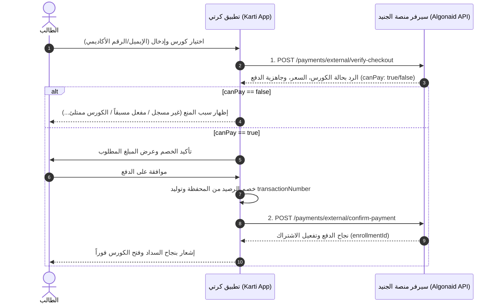

# دليل التكامل البرمجي لبوابة الدفع الخارجي (تطبيق كرتي)
## External Payment Integration Guide — Algonaid Platform API

> **تاريخ التحديث:** أكتوبر 2026  
> **الإصدار:** v1.0  
> **البيئة المعتمدة:** الإنتاج (Production)  
> **Base URL:** `https://api.exchangesmangement.online/api/v1`

---

## 1. نظرة عامة (Overview)

يوفر هذا الدليل المواصفات التقنية الكاملة لربط تطبيق **كرتي (Karti)** مع منصة **أكاديمية الجنيد**. تتيح هذه الواجهات سداد رسوم الكورسات وتفعيل اشتراك الطلاب فورياً وآلياً دون الحاجة لمراجعة يدوية لسندات الدفع.

### دورة السداد الموصى بها (Recommended Payment Flow):
1. **الخطوة الأولى (فحص الحساب والجاهزية):** يستدعي تطبيق كارتي `POST /payments/external/verify-checkout` للتأكد من وجود المستخدم، وتوثيق حسابه، وتوفر مقاعد بالكورس، وجلب السعر الدقيق بالعملة المحددة. **(يجب أن تتم هذه الخطوة قبل خصم أي فلس من محفظة العميل)**.
2. **الخطوة الثانية (الخصم المالي الداخلي):** يقوم تطبيق كارتي بخصم المبلغ من محفظة العميل وإصدار رقم عملية فريد (`transactionNumber`).
3. **الخطوة الثالثة (تأكيد السداد وتفعيل الاشتراك):** يستدعي تطبيق كارتي `POST /payments/external/confirm-payment` لإشعار المنصة باعتماد الدفع فورياً؛ حيث يتم تفعيل اشتراك الطالب لحظياً وإرسال إشعار ترحيبي له داخل المنصة.



---

## 2. المصادقة والأمان (Authentication & Security)

جميع الـ Endpoints الخارجية محمية بواسطة **مفتاح سري مشترك (Shared Secret API Key)**.  
يجب إرسال المفتاح ضمن ترويسات الطلب (HTTP Headers) في كل استدعاء.

### الـ Headers المطلوبة:
| اسم الـ Header | القيمة | إلزامي؟ | ملاحظات |
| :--- | :--- | :---: | :--- |
| `Content-Type` | `application/json` | نعم | نوع البيانات المُرسلة |
| `x-api-key` | `<EXTERNAL_PAYMENT_SECRET>` | **نعم** | المفتاح السري المشترك بين كرتي ومنصة الجنيد |

> **ملاحظة:** يدعم النظام أيضاً تمرير المفتاح عبر `x-karti-secret` أو عبر `Authorization: Bearer <API_KEY>`.

---

## 3. الـ Endpoint الأول: التحقق وفحص الجاهزية (Verify Checkout)

### `POST /payments/external/verify-checkout`
- **الرابط الكامل:** `https://api.exchangesmangement.online/api/v1/payments/external/verify-checkout`
- **الوظيفة:** التحقق من صلاحية المستخدم للتسجيل في الكورس ومعرفة السعر الدقيق والحسابات البنكية للمنصة قبل الخصم.

### جسم الطلب (Request Body)
```json
{
  "userIdentifier": "student@example.com",
  "courseId": 32,
  "currency": "YER_OLD"
}
```

#### تفاصيل الحقول:
| الحقل | النوع | إلزامي؟ | الوصف وأمثلة |
| :--- | :---: | :---: | :--- |
| `userIdentifier` | String | **نعم** | معرّف الطالب، ويقبل: **البريد الإلكتروني** (مثل `student@example.com`)، أو **الرقم الأكاديمي** (مثل `STU-1789538180865-1`)، أو رقم المعرّف الداخلي للمستخدم (`userId`). |
| `courseId` | Number | **نعم** | معرّف الكورس المراد سداد رسومه (رقم صحيح موجب، مثل `32`). |
| `currency` | String | لا | العملة المراد التحقق من تسعيرها. القيم المقبولة: `YER_OLD` (ريال يمني قديم/صنعاء - افتراضي)، `YER_NEW` (ريال يمني جديد/عدن)، `SAR` (ريال سعودي)، `USD` (دولار أمريكي). |

---

### أنواع الردود وحالاتها للـ Endpoint الأول (Responses):

#### الحالة 1: نجاح — جاهز للدفع (200 OK — Ready to Pay)
تتحقق هذه الحالة عندما يكون الطالب مسجلاً، وحسابه موثقاً، والكورس متاحاً ومدفوعاً ولم يكتمل مقاعده، وغير مشترك فيه مسبقاً.
```json
{
  "canPay": true,
  "status": "READY_TO_PAY",
  "message": "جاهز للدفع",
  "user": {
    "academicId": "STU-1789538180865-1",
    "name": "نذير الجنيد",
    "email": "student@example.com",
    "isAccountVerified": true
  },
  "course": {
    "id": 32,
    "title": "معسكر Flutter الاحترافي المتقدم — بث مباشر"
  },
  "capacity": {
    "maxStudents": 50,
    "enrolledCount": 14,
    "remainingSeats": 36,
    "isFull": false
  },
  "currency": "YER_OLD",
  "requiredAmount": 35000,
  "prices": {
    "YER_OLD": 35000,
    "YER_NEW": 35000,
    "SAR": 300,
    "USD": 80
  },
  "paymentAccounts": [
    {
      "id": 1,
      "provider": "بنك الكريمي",
      "accountHolder": "منصة الجنيد للتدريب",
      "accountNumber": "123456789",
      "currency": "YER_OLD",
      "instructions": "إيداع أو تحويل عبر تطبيق الكريمي جوال"
    }
  ]
}
```

---

#### الحالة 2: الطالب غير مسجل في المنصة (200 OK — USER_NOT_FOUND)
```json
{
  "canPay": false,
  "status": "USER_NOT_FOUND",
  "message": "المستخدم غير مسجل في المنصة"
}
```
*إجراء تطبيق كرتي:* تنبيه العميل بضرورة إنشاء حساب أولاً في تطبيق منصة الجنيد بنفس البريد الإلكتروني.

---

#### الحالة 3: حساب الطالب غير مؤكد عبر البريد (200 OK — ACCOUNT_NOT_VERIFIED)
```json
{
  "canPay": false,
  "status": "ACCOUNT_NOT_VERIFIED",
  "message": "حساب المستخدم غير مؤكد عبر البريد الإلكتروني. يرجى تأكيد الحساب أولاً قبل سداد الرسوم.",
  "user": {
    "academicId": "STU-1789538180865-1",
    "name": "نذير الجنيد",
    "email": "student@example.com",
    "isAccountVerified": false
  }
}
```
*إجراء تطبيق كرتي:* مطالبة الطالب بفتح بريده الإلكتروني وتأكيد حسابه برمز التفعيل قبل إتمام السداد.

---

#### الحالة 4: الكورس غير موجود (200 OK — COURSE_NOT_FOUND)
```json
{
  "canPay": false,
  "status": "COURSE_NOT_FOUND",
  "message": "الكورس غير موجود"
}
```

---

#### الحالة 5: الكورس مجاني (200 OK — COURSE_IS_FREE)
```json
{
  "canPay": false,
  "status": "COURSE_IS_FREE",
  "message": "هذا الكورس مجاني ولا يتطلب دفع",
  "course": {
    "id": 10,
    "title": "أساسيات لغة Dart للمبتدئين"
  }
}
```
*إجراء تطبيق كرتي:* إبلاغ الطالب أن الكورس مجاني ويمكنه التسجيل فيه مباشرة مجاناً من المنصة دون الحاجة للدفع.

---

#### الحالة 6: الكورس مكتمل المقاعد (200 OK — COURSE_FULL)
```json
{
  "canPay": false,
  "status": "COURSE_FULL",
  "message": "عذراً، لا يوجد مقاعد شاغرة في هذا الكورس؛ اكتمل العدد الأقصى للمسجلين وهو 50 طالباً.",
  "user": {
    "academicId": "STU-1789538180865-1",
    "name": "نذير الجنيد",
    "email": "student@example.com",
    "isAccountVerified": true
  },
  "course": {
    "id": 32,
    "title": "معسكر Flutter الاحترافي المتقدم — بث مباشر"
  },
  "capacity": {
    "maxStudents": 50,
    "enrolledCount": 50,
    "remainingSeats": 0,
    "isFull": true
  }
}
```
*إجراء تطبيق كرتي:* عدم خصم أي مبالغ وتنبيه المستخدم بأن المقاعد المتاحة في الكورس قد اكتملت.

---

#### الحالة 7: الطالب مشترك ومفعل مسبقاً (200 OK — ALREADY_ENROLLED)
```json
{
  "canPay": false,
  "status": "ALREADY_ENROLLED",
  "message": "المستخدم مشترك ومفعل في هذا الكورس مسبقاً",
  "user": {
    "academicId": "STU-1789538180865-1",
    "name": "نذير الجنيد",
    "email": "student@example.com",
    "isAccountVerified": true
  },
  "course": {
    "id": 32,
    "title": "معسكر Flutter الاحترافي المتقدم — بث مباشر"
  },
  "capacity": {
    "maxStudents": 50,
    "enrolledCount": 15,
    "remainingSeats": 35,
    "isFull": false
  },
  "currency": "YER_OLD",
  "requiredAmount": 35000,
  "prices": {
    "YER_OLD": 35000,
    "YER_NEW": 35000,
    "SAR": 300,
    "USD": 80
  },
  "paymentAccounts": [ ... ]
}
```
*إجراء تطبيق كرتي:* منع الدفع المزدوج وإشعار العميل بأنه يمتلك وصولاً مفعلاً بالفعل لهذا الكورس.

---

#### الحالة 8: توجد عملية دفع سابقة معلقة قيد المراجعة (200 OK — PENDING_PAYMENT)
```json
{
  "canPay": false,
  "status": "PENDING_PAYMENT",
  "message": "توجد عملية دفع سابقة قيد المراجعة والتدقيق لهذا الكورس",
  "user": { ... },
  "course": { ... },
  "capacity": { ... }
}
```
*إجراء تطبيق كرتي:* إبلاغ العميل بأن لديه إشعار دفع سابق يجري تدقيقه حالياً لدى إدارة المنصة.

---

#### الحالة 9: خطأ في المصادقة (401 Unauthorized — INVALID_API_KEY)
يحدث عند نسيان الـ `x-api-key` أو إرسال قيمة غير مطابقة:
```json
{
  "statusCode": 401,
  "message": "غير مصرح بالوصول: مفتاح الربط السري (x-api-key) مطلوب وغير صالح.",
  "error": "INVALID_API_KEY"
}
```

---

#### الحالة 10: خطأ في تحقق صحة البيانات المُرسلة (400 Bad Request — Validation Error)
يحدث عند إرسال معرّف كورس غير رقمي، أو ترك `userIdentifier` فارغاً:
```json
{
  "statusCode": 400,
  "message": [
    "معرّف المستخدم مطلوب للتحقق",
    "معرّف الكورس يجب أن يكون رقماً صحيحاً"
  ],
  "error": "Bad Request"
}
```

---

## 4. الـ Endpoint الثاني: تأكيد السداد الفوري وتفعيل الاشتراك (Confirm Payment)

### `POST /payments/external/confirm-payment`
- **الرابط الكامل:** `https://api.exchangesmangement.online/api/v1/payments/external/confirm-payment`
- **الوظيفة:** توثيق عملية الدفع الفوري الناجحة كـ `APPROVED`، وتفعيل اشتراك الطالب فورياً في الكورس (`enrollmentId != null`)، وإرسال إشعار ترحيبي للطالب.

### جسم الطلب (Request Body)
```json
{
  "userIdentifier": "student@example.com",
  "courseId": 32,
  "amount": 35000,
  "currency": "YER_OLD",
  "transactionNumber": "KARTI-9823145",
  "notes": "سداد إلكتروني مباشر عبر تطبيق كرتي"
}
```

#### تفاصيل الحقول:
| الحقل | النوع | إلزامي؟ | الوصف |
| :--- | :---: | :---: | :--- |
| `userIdentifier` | String | **نعم** | البريد الإلكتروني أو الرقم الأكاديمي STU-xxx أو userId للطالب. |
| `courseId` | Number | **نعم** | معرّف الكورس (رقم صحيح موجب). |
| `amount` | Number | **نعم** | المبلغ المدفوع بالكامل (يجب أن يطابق أو يتجاوز سعر الكورس بالعملة المحددة). |
| `currency` | String | لا | العملة (`YER_OLD`, `YER_NEW`, `SAR`, `USD`) — الافتراضي: `YER_OLD`. |
| `transactionNumber` | String | **يوصى به بشدة** | رقم العملية الصادر من تطبيق كرتي (فريد لكل عملية سداد لمنع التكرار). |
| `notes` | String | لا | أي ملاحظات توثيقية إضافية (تظهر للأدمن في سجلات السداد). |

---

### أنواع الردود وحالاتها للـ Endpoint الثاني (Responses):

#### الحالة 1: نجاح — اعتماد السداد وتفعيل اشتراك جديد لأول مرة (200 OK / 201 Created)
```json
{
  "success": true,
  "message": "تم سداد الرسوم واعتماد العملية وتفعيل اشتراك الطالب في الكورس بنجاح.",
  "data": {
    "enrollmentId": 142,
    "paymentId": 25,
    "status": "ACTIVE",
    "student": {
      "academicId": "STU-1789538180865-1",
      "name": "نذير الجنيد",
      "email": "student@example.com"
    },
    "course": {
      "id": 32,
      "title": "معسكر Flutter الاحترافي المتقدم — بث مباشر"
    },
    "payment": {
      "amount": 35000,
      "currency": "YER_OLD",
      "transactionNumber": "KARTI-9823145",
      "paidAt": "2026-10-19T21:30:00.000Z"
    }
  }
}
```
> **ملاحظة هامة:** حقل `enrollmentId` يُرجع رقم التسجيل الفعلي المفعل في قاعدة البيانات (لا يكون `null` أبداً عند نجاح العملية).

---

#### الحالة 2: نجاح آمن ومكرر — حماية تكرار العملية (200 OK — Idempotent Replay)
إذا انقطع اتصال الإنترنت لدى العميل بعد الخصم وأعاد تطبيق كرتي إرسال نفس الطلب بنفس `transactionNumber` لنفس الطالب ونفس الكورس:
```json
{
  "success": true,
  "message": "تم تسجيل واعتماد هذه العملية مسبقاً وتأكيد تفعيل الاشتراك بنجاح.",
  "data": {
    "enrollmentId": 142,
    "paymentId": 25,
    "status": "ACTIVE",
    "student": {
      "academicId": "STU-1789538180865-1",
      "name": "نذير الجنيد",
      "email": "student@example.com"
    },
    "course": {
      "id": 32,
      "title": "معسكر Flutter الاحترافي المتقدم — بث مباشر"
    },
    "payment": {
      "amount": 35000,
      "currency": "YER_OLD",
      "transactionNumber": "KARTI-9823145",
      "paidAt": "2026-10-19T21:30:00.000Z"
    }
  }
}
```
*إجراء تطبيق كرتي:* التعامل مع هذه الحالة كعملية **ناجحة 100%** وعرض سند النجاح للعميل دون أي خصم إضافي.

---

#### الحالة 3: خطأ في المصادقة (401 Unauthorized)
```json
{
  "statusCode": 401,
  "message": "غير مصرح بالوصول: مفتاح الربط السري (x-api-key) مطلوب وغير صالح.",
  "error": "INVALID_API_KEY"
}
```

---

#### الحالة 4: المستخدم غير مسجل في المنصة (404 Not Found)
```json
{
  "statusCode": 404,
  "message": "المستخدم غير مسجل في المنصة",
  "error": "Not Found"
}
```

---

#### الحالة 5: حساب الطالب غير مؤكد عبر البريد (403 Forbidden)
```json
{
  "statusCode": 403,
  "message": "حساب المستخدم غير مؤكد عبر البريد الإلكتروني. يرجى تأكيد الحساب أولاً قبل إتمام عملية السداد.",
  "error": "Forbidden"
}
```

---

#### الحالة 6: الكورس غير موجود (404 Not Found)
```json
{
  "statusCode": 404,
  "message": "الكورس المحدد غير موجود في المنصة",
  "error": "Not Found"
}
```

---

#### الحالة 7: الكورس مجاني (400 Bad Request)
```json
{
  "statusCode": 400,
  "message": "هذا الكورس مجاني ومتاح للتسجيل المباشر ولا يتطلب سداداً مالياً",
  "error": "Bad Request"
}
```

---

#### الحالة 8: اكتملت مقاعد الكورس (400 Bad Request)
```json
{
  "statusCode": 400,
  "message": "عذراً، لا يوجد مقاعد شاغرة في هذا الكورس؛ اكتمل العدد الأقصى للمسجلين وهو 50 طالباً.",
  "error": "Bad Request"
}
```

---

#### الحالة 9: المبلغ المدفوع أقل من سعر الكورس (400 Bad Request)
يحدث إذا تم تمرير مبلغ أقل من السعر الرسمي المحدد للكورس بتلك العملة:
```json
{
  "statusCode": 400,
  "message": "المبلغ المدفوع (25000 YER_OLD) أقل من سعر الكورس المطلوب (35000 YER_OLD)",
  "error": "Bad Request"
}
```

---

#### الحالة 10: الطالب مشترك ومفعل مسبقاً (409 Conflict)
يحدث إذا كان الطالب مشتركاً ومفعلاً بالفعل في الكورس وجاء طلب سداد جديد برقم عملية جديد:
```json
{
  "statusCode": 409,
  "message": "الطالب مشترك ومفعل في هذا الكورس مسبقاً",
  "error": "Conflict"
}
```

---

#### الحالة 11: رقم العملية مستخدم مسبقاً لكورس آخر أو لطالب آخر (409 Conflict)
حماية أمنية لمنع إعادة استخدام نفس إيصال الدفع لكورسات أخرى أو طلاب آخرين:
```json
{
  "statusCode": 409,
  "message": "رقم العملية هذا تم استخدامه واعتماده مسبقاً لعملية سداد أخرى.",
  "error": "Conflict"
}
```

---

#### الحالة 12: خطأ في تحقق المدخلات (400 Bad Request)
```json
{
  "statusCode": 400,
  "message": [
    "معرّف المستخدم مطلوب",
    "معرّف الكورس مطلوب",
    "المبلغ مطلوب",
    "المبلغ يجب أن يكون أكبر من صفر"
  ],
  "error": "Bad Request"
}
```

---

#### الحالة 13: خطأ داخلي في الخادم (500 Internal Server Error)
```json
{
  "statusCode": 500,
  "message": "Internal server error"
}
```
*إجراء تطبيق كرتي عند الـ 500 أو انقطاع الشبكة:* إعادة المحاولة (Retry) بعد 3 ثوانٍ **باستخدام نفس الـ `transactionNumber`**؛ حيث يضمن السيرفر عدم تكرار السحب والتعرف على العملية.

---

## 5. جدول الحالات وقرار المعالجة لمطور تطبيق كارتي (Action Matrix)

| Endpoint | HTTP Status | كود الحالة الداخلي | القرار والإجراء المطلوب من تطبيق كرتي |
| :--- | :---: | :--- | :--- |
| `verify-checkout` | **200 OK** | `status: "READY_TO_PAY"`, `canPay: true` | **السماح بالدفع**: عرض السعر والتأكيد والانتقال لخصم المحفظة. |
| `verify-checkout` | **200 OK** | `status: "USER_NOT_FOUND"` | **إيقاف**: إظهار رسالة "المستخدم غير مسجل في أكاديمية الجنيد". |
| `verify-checkout` | **200 OK** | `status: "ACCOUNT_NOT_VERIFIED"` | **إيقاف**: إظهار رسالة "يرجى تأكيد بريدك الإلكتروني في المنصة أولاً". |
| `verify-checkout` | **200 OK** | `status: "COURSE_FULL"` | **إيقاف**: إظهار رسالة "نعتذر، اكتملت مقاعد هذا الكورس بالكامل". |
| `verify-checkout` | **200 OK** | `status: "ALREADY_ENROLLED"` | **إيقاف**: إظهار رسالة "أنت مشترك ومفعل بالفعل في هذا الكورس". |
| `verify-checkout` | **200 OK** | `status: "PENDING_PAYMENT"` | **إيقاف**: إظهار رسالة "لديك سداد سابق معلق قيد المراجعة". |
| `confirm-payment` | **201 / 200** | `success: true` | **نجاح كامل**: طباعة الإيصال وإشعار العميل بتفعيل اشتراكه فوراً. |
| `confirm-payment` | **200 OK** | `success: true` (مكررة آمنة) | **نجاح**: العملية معتمدة مسبقاً، عرض الإيصال دون خصم مالي جديد. |
| كلاهما | **401** | `INVALID_API_KEY` | خطأ إعدادات: التحقق من صحة `x-api-key` المشترك بين المطورين. |
| `confirm-payment` | **400** | أقل من السعر المطلوب | إيقاف وعكس الخصم: إشعار العميل بأن المبلغ أقل من سعر الكورس. |
| `confirm-payment` | **409** | مشترك مسبقاً / رقم مكرر | إيقاف وعكس الخصم (إن وجد) وإظهار رسالة الخطأ الواردة. |
| `confirm-payment` | **500 / Network Timeout** | انقطاع اتصال | **إعادة محاولة (Retry)** بنفس الـ `transactionNumber`. |

---

## 6. أمثلة الاستدعاء البرمجية (Code Examples)

### أ. مثال cURL (Terminal)

#### 1. التحقق من الكورس:
```bash
curl -X POST "https://api.exchangesmangement.online/api/v1/payments/external/verify-checkout" \
  -H "Content-Type: application/json" \
  -H "x-api-key: algonaid_karti_secret_key_2026" \
  -d '{
    "userIdentifier": "admin@algonaid.com",
    "courseId": 32,
    "currency": "YER_OLD"
  }'
```

#### 2. تأكيد السداد الفوري:
```bash
curl -X POST "https://api.exchangesmangement.online/api/v1/payments/external/confirm-payment" \
  -H "Content-Type: application/json" \
  -H "x-api-key: algonaid_karti_secret_key_2026" \
  -d '{
    "userIdentifier": "admin@algonaid.com",
    "courseId": 32,
    "amount": 35000,
    "currency": "YER_OLD",
    "transactionNumber": "KARTI-9823145",
    "notes": "سداد إلكتروني مباشر عبر تطبيق كرتي"
  }'
```

---

### ب. مثال Dart / Flutter (باستخدام مكتبة `http` أو `dio`)

```dart
import 'dart:convert';
import 'package:http/http.dart' as http;

class KartiAlgonaidPaymentService {
  static const String baseUrl = 'https://api.exchangesmangement.online/api/v1/payments/external';
  static const String apiKey = 'algonaid_karti_secret_key_2026';

  static Map<String, String> get headers => {
    'Content-Type': 'application/json',
    'x-api-key': apiKey,
  };

  /// 1. التحقق من المستخدم والكورس والأسعار قبل الخصم
  static Future<Map<String, dynamic>> verifyCheckout({
    required String userIdentifier,
    required int courseId,
    String currency = 'YER_OLD',
  }) async {
    final response = await http.post(
      Uri.parse('$baseUrl/verify-checkout'),
      headers: headers,
      body: jsonEncode({
        'userIdentifier': userIdentifier,
        'courseId': courseId,
        'currency': currency,
      }),
    );

    return jsonDecode(response.body) as Map<String, dynamic>;
  }

  /// 2. تأكيد السداد بعد خصم الرصيد في كرتي وتفعيل اشتراك الطالب
  static Future<Map<String, dynamic>> confirmPayment({
    required String userIdentifier,
    required int courseId,
    required num amount,
    required String transactionNumber,
    String currency = 'YER_OLD',
    String? notes,
  }) async {
    final response = await http.post(
      Uri.parse('$baseUrl/confirm-payment'),
      headers: headers,
      body: jsonEncode({
        'userIdentifier': userIdentifier,
        'courseId': courseId,
        'amount': amount,
        'currency': currency,
        'transactionNumber': transactionNumber,
        'notes': notes ?? 'سداد إلكتروني مباشر عبر تطبيق كرتي',
      }),
    );

    return jsonDecode(response.body) as Map<String, dynamic>;
  }
}
```

---

### ج. مثال Node.js / JavaScript (باستخدام `axios`)

```javascript
const axios = require('axios');

const algonaidApi = axios.create({
  baseURL: 'https://api.exchangesmangement.online/api/v1/payments/external',
  headers: {
    'Content-Type': 'application/json',
    'x-api-key': 'algonaid_karti_secret_key_2026',
  },
  timeout: 10000,
});

// 1. التحقق من الكورس
async function verifyCourse(userIdentifier, courseId, currency = 'YER_OLD') {
  const { data } = await algonaidApi.post('/verify-checkout', {
    userIdentifier,
    courseId,
    currency,
  });
  return data;
}

// 2. تأكيد السداد وتفعيل الاشتراك
async function confirmCoursePayment({
  userIdentifier,
  courseId,
  amount,
  transactionNumber,
  currency = 'YER_OLD',
  notes = 'سداد إلكتروني عبر تطبيق كرتي',
}) {
  const { data } = await algonaidApi.post('/confirm-payment', {
    userIdentifier,
    courseId,
    amount,
    currency,
    transactionNumber,
    notes,
  });
  return data;
}
```

