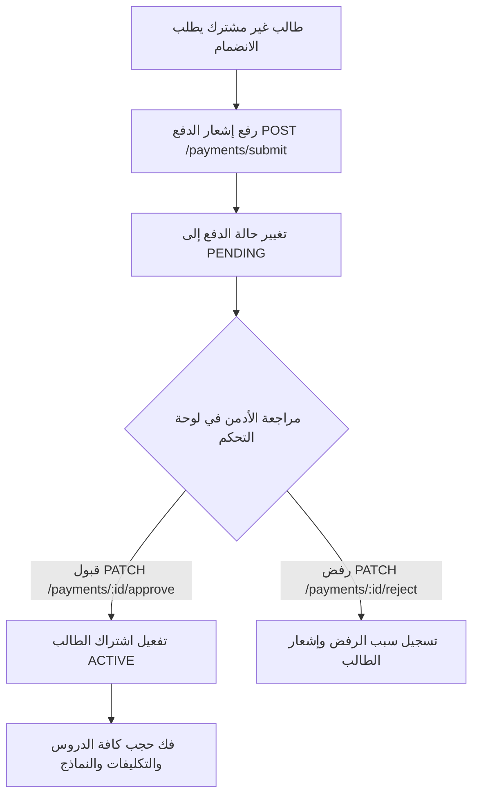

# 🌟 الدليل الشامل لنظام الكورسات المدفوعة والدروس والتكليفات والتقييم والشهادات
> **وثيقة معمارية وتوثيق API شامل لكافة ميزات الكورسات المدفوعة (Paid Courses Ecosystem)**  
> **Backend Service:** `algonaid-api` | **Version:** 2.0  
> **Target Audience:** مطوّرو لوحة تحكم الأدمن (Admin Dashboard) ومطوّرو تطبيقات الموبايل والويب.

---

# 📑 فهرس المحتويات
1. [نظرة عامة على دورة حياة الكورس المدفوع (Paid Course Lifecycle)](#1-نظرة-عامة-على-دورة-حياة-الكورس-المدفوع)
2. [إدارة الكورسات المدفوعة والمباشرة (Course Management & Conversion)](#2-إدارة-الكورسات-المدفوعة-والمباشرة)
3. [نظام المدفوعات والاشتراكات (Payments & Enrollment Flow)](#3-نظام-المدفوعات-والاشتراكات)
4. [الدروس في الكورس المدفوع، المعاينة، والحجب (Lessons & Content Protection)](#4-الدروس-في-الكورس-المدفوع-المعاينة-والحجب)
5. [المحاضرات والبث المباشر (Live Lectures & Status Lifecycle)](#5-المحاضرات-والبث-المباشر)
6. [نظام التكليفات والواجبات (Assignments & Auto-Graded Quizzes)](#6-نظام-التكليفات-والواجبات)
7. [بطاقة التقييم الشامل، المعدل التراكمي، وخارطة المسار الزمني (Evaluation & Timeline)](#7-بطاقة-التقييم-الشامل-المعدل-التراكمي-وخارطة-المسار-الزمني)
8. [نظام إصدار وتوثيق الشهادات المعتمدة (Certificates & QR Verification)](#8-نظام-إصدار-وتوثيق-الشهادات-المعتمدة)
9. [حماية النماذج والمراجع والاختبارات النهائية (Practice Exams & Final Exams Security)](#9-حماية-النماذج-والمراجع-والاختبارات-النهائية)
10. [مرجع جميع الـ Endpoints والـ Payloads والـ Responses](#10-مرجع-جميع-الـ-endpoints-والـ-payloads-والـ-responses)

---

## 1. نظرة عامة على دورة حياة الكورس المدفوع

تم تصميم نظام الكورسات المدفوعة في المنصة ليخدم نوعين رئيسيين من التعليم:
1. **الكورسات المسجلة (Recorded Courses):** دورات تعتمد على محتوى مسجل وفيديوهات وملفات ومسار تدريبي تفاعلي.
2. **الكورسات التفاعلية المباشرة (Live Interactive Bootcamps):** دورات تبدأ وتنتهي في تواريخ محددة، ولها جدول أسبوعي ومحاضرات بث مباشر عبر (Google Meet أو Zoom)، وتسجيلات للمحاضرات، وتكليفات يومية ملزمة لاستحقاق الشهادة.

### المفاهيم الأساسية:
- **`isPaid: true`**: يفعّل طبقة الحماية الشاملة للمحتوى (Content Masking & Protection).
- **`isFreePreview: true`**: يسمح بفتح درس أو درسين للطلاب غير المشتركين كمعاينة وتجربة مجانية قبل الشراء.
- **`isEnrolled: true`**: يتحقق تلقائياً من وجود اشتراك نشط (`ACTIVE`) للوصول للمحتوى الكامل.
- **التتابع الإلزامي (Prerequisites):** في الكورسات المدفوعة، لا يمكن فتح الاختبارات أو المحاضرات إلا بعد إنهاء المتطلبات السابقة بالتسلسل.

---

## 2. إدارة الكورسات المدفوعة والمباشرة

### أ. إنشاء كورس مدفوع (`POST /courses`)
عند إنشاء كورس مدفوع، يحدد الأدمن أسعار الدورة، نوعها، جدولها، وشروط استحقاق الشهادة:

- **الحقول الخاصة بالكورس المدفوع:**
  - `isPaid` *(boolean)*: تفعيل كون الدورة مدفوعة (`true`).
  - `price` *(number)*: السعر الأساسي للدورة.
  - `discountedPrice` *(number, اختياري)*: السعر بعد الخصم أثناء العروض.
  - `courseType` *(Enum: `RECORDED` | `LIVE`)*: نوع الدورة.
  - `startDate` *(ISO Date, للدورات المباشرة)*: تاريخ بدء الدورة.
  - `endDate` *(ISO Date, للدورات المباشرة)*: تاريخ انتهاء الدورة.
  - `durationWeeks` *(number, اختياري)*: مدة الدورة بالأسابيع.
  - `scheduleDays` *(string[], اختياري)*: مصفوفة الأيام والمواعيد (مثل `["الأحد 8:00م", "الثلاثاء 8:00م"]`).
  - `scheduleDaysText` *(string, اختياري)*: نص توضيحي للمواعيد.
  - `objectives` *(string[], اختياري)*: أهداف ومخرجات الدورة.
  - `certificateMinScore` *(number, 0-100, افتراضي: 70)*: الحد الأدنى للمعدل التراكمي لاستحقاق الشهادة.
  - `certificateMinAttendance` *(number, 0-100, افتراضي: 80)*: الحد الأدنى لنسبة الحضور لاستحقاق الشهادة.

### ب. تحويل الدورة المباشرة إلى كورس مسجل (`POST /courses/:id/convert-to-recorded`)
بعد انتهاء الدورة التفاعلية المباشرة، يمكن للأدمن تحويلها بنقرة واحدة إلى كورس مسجل ليتم بيعه باستمرار:
1. يتم تحويل `courseType` إلى `RECORDED`.
2. يتم تفريغ روابط لقاءات البث المباشر القديمة (`liveMeetingUrl = null`) من كافة الدروس.
3. يتم تحديث السعر الأساسي وسعر الخصم الجديد.

---

## 3. نظام المدفوعات والاشتراكات (Payments & Enrollment)

يعتمد النظام دورة تدقيق مالي صارمة ومريحة للطالب والأدمن:



### خط سير العملية:
1. **رفع إشعار التحويل من الطالب (`POST /payments/submit`):**
   - يرسل الطالب: `courseId`، `transactionNumber` (رقم الحوالة/العملية)، `amount`، `transferMethod` (الكريمي، النجم، تحويل بنكي، إلخ)، و `receiptUrl` (صورة سند التحويل).
2. **فحص المدفوعات المعلقة للأدمن (`GET /payments/pending`):**
   - يظهر للأدمن جدول بجميع الإيصالات المعلقة مع صورة السند ورقم الحوالة وتفاصيل الطالب.
3. **اعتماد الدفع (`PATCH /payments/:id/approve`):**
   - بمجرد النقر على "قبول"، يقوم الباك إند بإنشاء أو تفعيل اشتراك الطالب (`Enrollment`) في الكورس بحالة `ACTIVE`.
   - يصل إشعار مباشر وفوري للطالب بقبول انضمامه للكورس وتفعيل حسابه.

---

## 4. الدروس في الكورس المدفوع، المعاينة، والحجب (Content Protection)

تعتمد المنصة خوارزمية حماية ذكية للمحتوى في الباك إند (`Content Masking`):

### خوارزمية الحجب التلقائي (`shouldMask`):
```typescript
const isUnenrolledPaid = isPaidCourse && !isEnrolled && !lesson.isFreePreview;
const shouldMask = !isStaff && (isUnenrolledPaid || isScheduledFuture);
```

### تأثير الحجب على استجابة الـ API:
عندما يكون `shouldMask = true` (الطالب غير مشترك في كورس مدفوع ولم يكن الدرس معاينة مجانية):
- `videoUrl` ⬅️ يتحول إلى `null`.
- `recordingVideoUrl` ⬅️ يتحول إلى `null`.
- `pdfUrl` ⬅️ يتحول إلى `null`.
- `liveMeetingUrl` ⬅️ يتحول إلى `null`.
- `isLocked` ⬅️ يرجع بقيمة `true`.
- `exam` و `assignment` ⬅️ لا يتم إرجاعهما نهائياً (`null`).
- يبقى فقط عنوان الدرس، ترتيبه، ووصفه العام متاحاً ليعرف الطالب خطة المنهج.

### المعاينة المجانية (`isFreePreview: true`):
- يمكن للأدمن تحديد أي درس ليكون `"isFreePreview": true`.
- هذا الدرس يُعفى من الحجب ويستطيع أي زائر غير مسجل مشاهدة الفيديو والملف الخاص به لتجربة أسلوب الشرح قبل اتخاذ قرار الشراء.

---

## 5. المحاضرات والبث المباشر (Live Lectures & Status Lifecycle)

في الكورسات المباشرة (`LIVE`)، يمتلك كل درس دورة حياة خاصة بالبث المباشر:

### حالات البث المباشر (`LiveStatus`):
| الحالة | الوصف | تصرف النظام وتجربة المستخدم |
| :--- | :--- | :--- |
| **`SCHEDULED`** | محاضرة مجدولة قادمة | يظهر موعد المحاضرة والعد التنازلي. إذا كان موعدها في المستقبل، يُحجب رابط الاجتماع لغير الأدمن حتى يحين موعدها. |
| **`LIVE_NOW`** | المحاضرة تبث الآن مباشرة | يُفتح رابط الاجتماع (`liveMeetingUrl`) فورياً للمشتركين ويظهر وميض وزر "انضم للبث المباشر الآن". |
| **`COMPLETED`** | انتهت المحاضرة المباشرة | يُقفل رابط الاجتماع المباشر ويُعرض رابط تسجيل المحاضرة (`recordingVideoUrl`) ليراجعها الطلاب في أي وقت. |
| **`CANCELLED`** | أُلغيت أو أُجلت المحاضرة | إشعار للطلاب بتأجيل المحاضرة. |

### تحديث حالة البث ورابط التسجيل (`PATCH /lessons/:id/live-status`):
يمكن للأدمن بضغطة زر بدء البث المباشر أو إنهاؤه وإدراج رابط التسجيل:
```json
{
  "liveStatus": "COMPLETED",
  "recordingVideoUrl": "https://storage.algonaid.com/recordings/flutter-lecture-1.mp4"
}
```

---

## 6. نظام التكليفات والواجبات (Assignments & Auto-Graded Quizzes)

يمتلك نظام التكليفات في المنصة نوعين رئيسيين:

### النوع الأول: التكليف العملي (`type: TASK`)
- يضع المعلم/الأدمن متطلبات المشروع، ويمكنه إرفاق ملف تعليمات (`attachmentUrl`).
- يسلم الطالب الحل عبر:
  - رفع ملف تطبيقي أو PDF (`file`).
  - أو كتابة نص أو إرفاق رابط خارجي (مستودع GitHub، رابط Figma، مسودة Google Drive) عبر حقل `content`.
- **التصحيح والمراجعة:**
  - يدخل الأدمن/المعلم على `GET /assignments/:id/submissions` لمشاهدة حلول الطلاب.
  - يصحح التسليم عبر `POST /assignments/submissions/:submissionId/grade`:
    - يحدد الدرجة (`score`).
    - يكتب ملاحظات التقييم (`feedback`).
    - يرفق صورة تصحيح أو كود توضيحي (`feedbackImage`).
    - يحدد حالة التقييم (`GRADED` أو يطلب إعادة التسليم `RESUBMISSION_REQUESTED`).

### النوع الثاني: التكليف التلقائي المؤتمت (`type: QUIZ`)
- يتم إنشاؤه عبر ربطه باختبار درس (`asAssignment: true` أو `examId`).
- بمجرد أن يحل الطالب الكويز ويسلم إجاباته، يقوم النظام آلياً بـ:
  1. حساب النسبة المئوية لإجابات الطالب.
  2. رصد الدرجة فورياً في سجل التكليفات (`AssignmentSubmission`).
  3. تغيير الحالة تلقائياً إلى `GRADED`.
  4. تسجيل محتوى: `"تم إتمام الكويز التلقائي بنسبة 90% (18/20)"`.
  5. لا يحتاج أي تدخل يدوي من المعلم للتصحيح.

---

## 7. بطاقة التقييم الشامل، المعدل التراكمي، وخارطة المسار الزمني

من خلال `GET /courses/:id/my-evaluation`، يحصل الطالب والأدمن على بطاقة أداء أكاديمي تفصيلية تضم:

### أ. محرك احتساب الدرجة التراكمية (Cumulative GPA Engine):
يتم احتساب المعدل التراكمي بنظام المعادلة الوزنية الدقيقة:
- **في حال وجود تكليفات واختبارات معاً:**
  $$\text{GPA} = (\text{Attendance} \times 0.20) + (\text{Assignments Avg} \times 0.45) + (\text{Quizzes Avg} \times 0.35)$$
- **في حال وجود تكليفات فقط:**
  $$\text{GPA} = (\text{Attendance} \times 0.30) + (\text{Assignments Avg} \times 0.70)$$
- **في حال وجود اختبارات فقط:**
  $$\text{GPA} = (\text{Attendance} \times 0.30) + (\text{Quizzes Avg} \times 0.70)$$

### ب. جدول التقديرات الأكاديمية (Grade Letter):
| النسبة المئوية | التقدير الحرفي | الوصف |
| :---: | :---: | :--- |
| **95% - 100%** | **A+** | ممتاز مرتفع |
| **90% - 94%** | **A** | ممتاز |
| **85% - 89%** | **B+** | جيد جداً مرتفع |
| **80% - 84%** | **B** | جيد جداً |
| **75% - 79%** | **C+** | جيد مرتفع |
| **70% - 74%** | **C** | جيد |
| **60% - 69%** | **D** | مقبول |
| **أقل من 60%** | **F** | راسب |

### ج. خارطة المسار الزمني اليومية (`dailyTimeline`):
مصفوفة متسلسلة يوم بيوم أو درس بدرس تحتوي على:
- رقم اليوم (`dayNumber`) واسم المحاضرة وأهدافها وموعدها المجدول.
- حالة حضور ومشاهدة الطالب (`isAttended` / `isCompleted`).
- بيانات التكليف اليومي: هل تم التسليم؟ الدرجة المرصودة، والملاحظات.
- بيانات الاختبار اليومي: هل تم الاجتياز؟ والدرجة المحققة.

---

## 8. نظام إصدار وتوثيق الشهادات المعتمدة

### شروط استحقاق الشهادة المبرمجة آلياً:
لكي يتمكن الطالب من طلب الشهادة عبر `POST /courses/:id/certificate/claim`:
1. أن تكون نسبة حضوره $\ge$ `certificateMinAttendance` (افتراضياً 80%).
2. أن يكون معدله التراكمي $\ge$ `certificateMinScore` (افتراضياً 70%).
3. أن يكون قد قام بتسليم كافة التكليفات المطلوبة في الدورة.

### بيانات الشهادة الصادرة:
- **الرقم التسلسلي الأكاديمي (`serialNumber`):**
  - تنسيق موحد: `ALG-{YEAR}-C{COURSE_ID}-S{STUDENT_ID}-{RANDOM_4_DIGITS}`
  - مثال: `ALG-2026-C5-S12-8492`
- **رابط التحقق السريع عبر الـ QR Code (`qrCodeUrl`):**
  - `https://algonaid.com/certificates/verify/ALG-2026-C5-S12-8492`
  - يتيح لأصحاب العمل والجهات الخارجية فحص صحة الشهادة ومعاينة درجة الطالب وتاريخ الإصدار مباشرة عبر الويب.

---

## 9. حماية النماذج والمراجع والاختبارات النهائية

1. **النماذج والمراجع (`Practice Exams`):**
   - **في الباك إند:** فحص أمني صارم؛ إذا كان الكورس مدفوعاً (`course.isPaid`) والمستخدم غير مسجل، يرفض الطلب فوراً برمز `403 Forbidden` برسالة: *"نماذج ومراجع هذه الدورة متاحة فقط للمشتركين والمسجلين فيها"*.
   - **في الفرونت إند:** لا يتم إظهار تبويب النماذج والمراجع أساساً لغير المشتركين في الكورس المدفوع.
2. **الاختبار النهائي للدورة (`Course Final Exam`):**
   - في الكورسات المدفوعة، لا يمكن فتح الاختبار النهائي إلا بعد إكمال كافة الدروس السابقة واجتياز جميع الاختبارات المرحلية.

---

## 10. مرجع جميع الـ Endpoints والـ Payloads والـ Responses

---

### 1. الكورسات (Courses)

#### إنشاء كورس مدفوع جديد
`POST /courses` (Admin, Owner)
```json
{
  "title": "معسكر احتراف تطوير تطبيقات فلاتر 2026",
  "description": "معسكر تطبيقي متكامل لبناء وتطوير تطبيقات الموبايل الحقيقية",
  "thumbnail": "https://ucarecdn.com/course-thumb.jpg",
  "isPaid": true,
  "price": 120.00,
  "discountedPrice": 80.00,
  "priceYerOld": 50000.00,
  "discountedPriceYerOld": 35000.00,
  "priceYerNew": 150000.00,
  "discountedPriceYerNew": 100000.00,
  "priceSar": 300.00,
  "discountedPriceSar": 200.00,
  "courseType": "LIVE",
  "startDate": "2026-11-01T00:00:00.000Z",
  "endDate": "2026-12-30T23:59:59.000Z",
  "durationWeeks": 8,
  "scheduleDays": ["السبت 8:00م", "الثلاثاء 8:00م"],
  "scheduleDaysText": "السبت والثلاثاء من كل أسبوع الساعة 8:00 مساءً بتوقيت مكة",
  "objectives": [
    "إتقان أساسيات لغة Dart المتقدمة",
    "احتراف معمارية Clean Architecture و Bloc",
    "ربط التطبيقات بـ REST APIs و Firebase",
    "نشر التطبيقات على Google Play و App Store"
  ],
  "certificateMinScore": 70,
  "certificateMinAttendance": 80
}
```

#### تحويل دورة مباشرة إلى كورس مسجل
`POST /courses/:id/convert-to-recorded` (Admin, Owner)
```json
{
  "price": 60.00,
  "discountedPrice": 40.00
}
```
**Response (200 OK):**
```json
{
  "message": "تم تحويل الدورة المباشرة إلى كورس مسجل بنجاح وتفريغ روابط البث المباشر.",
  "course": {
    "id": 5,
    "title": "معسكر احتراف تطوير تطبيقات فلاتر 2026",
    "courseType": "RECORDED",
    "price": 60.00,
    "discountedPrice": 40.00
  }
}
```

---

### 2. المدفوعات والاشتراكات وحسابات الاستقبال (Payments, Accounts & External Verification)

#### جلب حسابات ومحافظ الاستقبال النشطة (للطلاب والتطبيقات)
`GET /payments/accounts?currency=YER_OLD` (الجميع)
**Response (200 OK):**
```json
[
  {
    "id": 1,
    "providerTitle": "بنك الكريمي للتمويل الأصغر الإسلامي",
    "accountHolder": "بشار أحمد الجنيد",
    "accountNumber": "12345678",
    "currency": "YER_OLD",
    "instructions": "يرجى كتابة اسم الطالب ورقم الهاتف في خانة الغرض من الحوالة.",
    "qrCodeUrl": "https://ucarecdn.com/kuraimi-qr.png",
    "isActive": true,
    "order": 1
  },
  {
    "id": 2,
    "providerTitle": "محفظة ون كاش الإلكترونية (OneCash)",
    "accountHolder": "بشار أحمد الجنيد",
    "accountNumber": "777123456",
    "currency": "YER_OLD",
    "instructions": "إيداع مباشر عبر رقم المحفظة",
    "qrCodeUrl": null,
    "isActive": true,
    "order": 2
  }
]
```

#### إضافة حساب بنكي أو محفظة جديدة (لوحة التحكم)
`POST /payments/accounts` (Admin, Owner)
```json
{
  "providerTitle": "بنك القطيبي الإسلامي",
  "accountHolder": "بشار أحمد الجنيد",
  "accountNumber": "88812345",
  "currency": "YER_NEW",
  "instructions": "تحويل لحساب القطيبي بالعملة الجديدة (عدن)",
  "isActive": true,
  "order": 3
}
```

#### تعديل بيانات حساب أو تفعيله/تعطيله
`PATCH /payments/accounts/:id` (Admin, Owner)
```json
{
  "isActive": false
}
```

#### تقديم إشعار دفع جديد من الطالب
`POST /payments/submit` (Student)
```json
{
  "courseId": 5,
  "amount": 35000.00,
  "currency": "YER_OLD",
  "paymentAccountId": 1,
  "transactionNumber": "TRX-9823145",
  "receiptUrl": "https://ucarecdn.com/receipt-image.jpg",
  "notes": "تم التحويل عبر تطبيق الكريمي جوال"
}
```

#### جلب الإيصالات المعلقة للمراجعة
`GET /payments/pending?page=1&limit=20` (Admin, Owner)

#### قبول إشعار الدفع وتفعيل الطالب
`PATCH /payments/:id/approve` (Admin, Owner)
**Response (200 OK):**
```json
{
  "message": "تم اعتماد إشعار الدفع وتفعيل اشتراك الطالب بنجاح",
  "payment": {
    "id": 42,
    "status": "APPROVED",
    "courseId": 5,
    "studentId": 12,
    "currency": "YER_OLD",
    "amount": 35000.00
  }
}
```

#### رفض إشعار الدفع مع ذكر السبب
`PATCH /payments/:id/reject` (Admin, Owner)
```json
{
  "rejectionReason": "صورة السند غير واضحة ورقم الحوالة غير مطابق"
}
```

#### فحص والتحقق من صلاحية المستخدم للدفع لتطبيق خارجي (Checkout Verification)
`POST /payments/external/verify-checkout`
- **Request Body:**
```json
{
  "userIdentifier": "STU-1729241-12", // يقبل الرقم الأكاديمي أو البريد الإلكتروني أو ID
  "courseId": 5,
  "currency": "YER_OLD" // اختياري: YER_OLD (افتراضي), YER_NEW, SAR
}
```
- **Response (200 OK):**
```json
{
  "canPay": true,
  "status": "READY_TO_PAY",
  "message": "جاهز للدفع",
  "user": {
    "academicId": "STU-1729241-12",
    "name": "أحمد علي",
    "email": "student@example.com",
    "isAccountVerified": true
  },
  "course": {
    "id": 5,
    "title": "معسكر احتراف تطوير تطبيقات فلاتر 2026"
  },
  "currency": "YER_OLD",
  "requiredAmount": 35000,
  "prices": {
    "YER_OLD": 35000,
    "YER_NEW": 100000,
    "SAR": 200
  },
  "paymentAccounts": [
    {
      "id": 1,
      "provider": "بنك الكريمي للتمويل الأصغر الإسلامي",
      "accountHolder": "بشار أحمد الجنيد",
      "accountNumber": "12345678",
      "currency": "YER_OLD",
      "instructions": "يرجى كتابة الرقم الأكاديمي في الملاحظات"
    }
  ]
}
```

---

### 3. الدروس (Lessons)

#### إضافة درس جديد للكورس
`POST /lessons` (Admin, Owner)  
*(يدعم Multipart/form-data في حال رفع ملف PDF عبر حقل `pdf`)*
```json
{
  "moduleId": 10,
  "title": "المحاضرة الأولى: هندسة بنية التطبيقات",
  "description": "شرح عملي لمفهوم Clean Architecture",
  "content": "تفاصيل ومحاور المحاضرة...",
  "videoUrl": "https://storage.algonaid.com/videos/lesson1.mp4",
  "isFreePreview": false,
  "dayNumber": 1,
  "scheduledAt": "2026-11-01T17:00:00.000Z",
  "durationMinutes": 90,
  "liveStatus": "SCHEDULED",
  "liveMeetingUrl": "https://meet.google.com/xyz-abcd-efg",
  "isMandatory": true,
  "objectives": ["فهم طبقات Data و Domain و Presentation"]
}
```

#### تحديث حالة البث المباشر ورابط التسجيل
`PATCH /lessons/:id/live-status` (Admin, Owner)
```json
{
  "liveStatus": "LIVE_NOW",
  "recordingVideoUrl": null
}
```

---

### 4. التكليفات (Assignments)

#### إنشاء تكليف جديد لدرس
`POST /assignments` (Admin, Owner)  
*(يدعم Multipart/form-data في حال رفع ملف مرفق عبر حقل `attachment`)*
```json
{
  "lessonId": 25,
  "title": "تكليف اليوم الأول: بناء طبقة Network مع Dio",
  "description": "قم بإنشاء ApiClient مع معالجة الـ Interceptors وتجربة جلب قائمة البيانات",
  "type": "TASK",
  "maxScore": 100,
  "dueDate": "2026-11-03T23:59:59.000Z",
  "attachmentUrl": "https://ucarecdn.com/task-instructions.pdf"
}
```

#### تسليم الطالب للتكليف
`POST /assignments/:id/submit` (Student)  
*(يدعم رفع ملف تطبيقي عبر حقل `file`)*
```json
{
  "content": "تم إنجاز المطلوب، المستودع متاح على GitHub: https://github.com/student/flutter-task-1",
  "fileUrl": "https://ucarecdn.com/student-solution.zip"
}
```

#### تصحيح تسليم الطالب ووضع الدرجة
`POST /assignments/submissions/:submissionId/grade` (Admin, Owner)  
*(يدعم رفع صورة توضيحية عبر حقل `feedbackImage`)*
```json
{
  "score": 95,
  "feedback": "عمل ممتاز جداً والتزام تام بمعايير Clean Architecture. انتبه فقط لمعالجة Timeout في السطر 42.",
  "feedbackImageUrl": "https://ucarecdn.com/feedback-correction.png",
  "status": "GRADED"
}
```

---

### 5. التقييم والشهادات (Evaluation & Certificates)

#### استعلام تقييم الطالب ومساره اليومي
`GET /courses/:id/my-evaluation` (Student, Admin)
**Response (200 OK):**
```json
{
  "course": {
    "id": 5,
    "title": "معسكر احتراف تطوير تطبيقات فلاتر 2026",
    "startDate": "2026-11-01T00:00:00.000Z",
    "endDate": "2026-12-30T23:59:59.000Z",
    "durationWeeks": 8,
    "teacher": {
      "name": "م. بشار الجنيد",
      "avatar": "https://ucarecdn.com/teacher.jpg"
    }
  },
  "student": {
    "id": 12,
    "academicId": "STU-2026-0012",
    "name": "أحمد علي",
    "avatar": "https://ucarecdn.com/student.jpg"
  },
  "summary": {
    "overallProgressPercentage": 100,
    "cumulativeGpa": 92,
    "gradeLetter": "A",
    "attendancePercentage": 95,
    "completedLessonsCount": 20,
    "totalLessonsCount": 20,
    "totalAssignmentsCount": 10,
    "submittedAssignmentsCount": 10,
    "assignmentsAverageScore": 90,
    "totalExamsCount": 5,
    "passedExamsCount": 5,
    "quizzesAverageScore": 94,
    "certificateRequirements": {
      "minScore": 70,
      "minAttendance": 80,
      "isEligible": true,
      "isIssued": false
    },
    "certificate": null
  },
  "dailyTimeline": [
    {
      "dayNumber": 1,
      "lessonId": 25,
      "lessonTitle": "المحاضرة الأولى: هندسة بنية التطبيقات",
      "scheduledAt": "2026-11-01T17:00:00.000Z",
      "liveStatus": "COMPLETED",
      "isAttended": true,
      "isCompleted": true,
      "completedAt": "2026-11-01T19:30:00.000Z",
      "assignment": {
        "id": 15,
        "title": "تكليف اليوم الأول: بناء طبقة Network",
        "type": "TASK",
        "maxScore": 100,
        "dueDate": "2026-11-03T23:59:59.000Z",
        "status": "GRADED",
        "submittedAt": "2026-11-02T14:20:00.000Z",
        "score": 95,
        "feedback": "عمل ممتاز جداً والتزام تام بالمعايير",
        "feedbackImageUrl": null
      },
      "exam": null
    }
  ]
}
```

#### إصدار والمطالبة بالشهادة المعتمدة
`POST /courses/:id/certificate/claim` (Student)
**Response (201 Created):**
```json
{
  "id": 8,
  "serialNumber": "ALG-2026-C5-S12-4819",
  "finalGrade": 92,
  "issueDate": "2026-12-30T10:00:00.000Z",
  "qrCodeUrl": "https://algonaid.com/certificates/verify/ALG-2026-C5-S12-4819"
}
```

