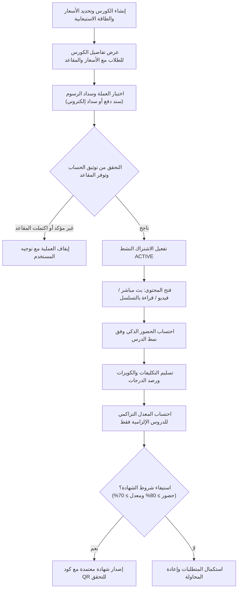

# 🌟 الدليل الشامل والمعماري لنظام الكورسات المدفوعة والدروس والمدفوعات والتقييم الأكاديمي والشهادات
> **وثيقة معمارية وتوثيق API شامل لكافة ميزات منظومة الكورسات المدفوعة (Paid Courses & Payments Ecosystem)**  
> **Backend Service:** `algonaid-api` (NestJS + Prisma + PostgreSQL) | **Version:** 2.2  
> **Target Audience:** مطوّرو لوحة تحكم الأدمن (Admin Dashboard)، مطوّرو تطبيقات الموبايل (Flutter)، مطوّرو بوابات الدفع والتطبيقات الخارجية (مثل تطبيق كرتي).

---

# 📑 فهرس المحتويات
1. [نظرة عامة على دورة حياة الكورس المدفوع (Paid Course Lifecycle)](#1-نظرة-عامة-على-دورة-حياة-الكورس-المدفوع)
2. [إدارة الكورسات، الطاقة الاستيعابية، والتسعير متعدد العملات (Course Management, Capacity & Multi-Currency)](#2-إدارة-الكورسات-والطاقة-الاستيعابية-والتسعير-متعدد-العملات)
3. [نظام المدفوعات والاشتراكات والربط الخارجي (Payments, Accounts & External Checkout)](#3-نظام-المدفوعات-والاشتراكات-والربط-الخارجي)
4. [الدروس، الجدولة الزمنية، والترتيب والحجب (Lessons, Scheduling, Ordering & Protection)](#4-الدروس-الجدولة-الزمنية-والترتيب-والحجب)
5. [المحاضرات المباشرة وقواعد احتساب الحضور الذكية (Live Lectures & Attendance Tracking)](#5-المحاضرات-المباشرة-وقواعد-احتساب-الحضور-الذكية)
6. [الدروس الإلزامية مقابل الدروس الاختيارية (Mandatory vs. Optional Lessons)](#6-الدروس-الإلزامية-مقابل-الدروس-الاختيارية)
7. [نظام التكليفات والواجبات (Assignments & Auto-Graded Quizzes)](#7-نظام-التكليفات-والواجبات)
8. [محرك التقييم الأكاديمي الشامل والمعدل التراكمي (Evaluation Engine & Cumulative GPA)](#8-محرك-التقييم-الأكاديمي-الشامل-والمعدل-التراكمي)
9. [إصدار وتوثيق الشهادات المعتمدة (Certificates & QR Verification)](#9-إصدار-وتوثيق-الشهادات-المعتمدة)
10. [دورة حياة توثيق الحسابات وفترة السماح (Account Verification & Grace Period Lifecycle)](#10-دورة-حياة-توثيق-الحسابات-وفترة-السماح)
11. [حماية النماذج والمراجع والاختبارات النهائية (Exams & Resources Security)](#11-حماية-النماذج-والمراجع-والاختبارات-النهائية)
12. [مرجع جميع الـ Endpoints والـ Payloads والـ Responses التفصيلي](#12-مرجع-جميع-الـ-endpoints-والـ-payloads-والـ-responses-التفصيلي)

---

## 1. نظرة عامة على دورة حياة الكورس المدفوع

تم تصميم نظام الكورسات المدفوعة في منصة الجنيد ليدعم نموذجين تعليميين متقدمين:
1. **الكورسات المسجلة (Recorded Courses):** دورات تعتمد على محتوى مسجل مسبقاً (فيديوهات، ملفات، قراءات، كويزات، وتكليفات) تتيح للطالب التعلّم الذاتي وفق سرعته الخاصة.
2. **المعسكرات التفاعلية المباشرة (Live Interactive Bootcamps):** دورات تبدأ وتنتهي في تواريخ محددة (`startDate` - `endDate`)، ذات طاقة استيعابية محدودة (`maxStudents`)، ولها جدول أسبوعي بمحاضرات تفاعلية عبر Google Meet أو Zoom، مع تكليفات ومشاريع يومية مشروطة بحد أدنى للحضور والمعدل لاستحقاق الشهادة.



---

## 2. إدارة الكورسات، الطاقة الاستيعابية، والتسعير متعدد العملات

### أ. الطاقة الاستيعابية المحدودة (`maxStudents`)
لضمان جودة المعسكرات المباشرة وتوفير متابعة شخصية لكل طالب:
- **`maxStudents`** *(عدد صحيح اختياري)*: يمثل الحد الأقصى للمقاعد المتاحة. إذا كان `null`، فهذا يعني أن الكورس مفتوح لعدد غير محدود.
- **منطق التحقق البرمجي:**
  - يتم فحص عدد الاشتراكات النشطة (`status = ACTIVE`).
  - إذا وصل العدد إلى `maxStudents`، يُحظر تقديم أي طلبات دفع جديدة ويُمنع التسجيل المباشر عبر رسالة واضحة:  
    *"عذراً، لا يوجد مقاعد شاغرة في هذا الكورس؛ اكتمل العدد الأقصى للمسجلين وهو X طالباً."*
  - في واجهة التطبيق، يُعرض في تفاصيل الكورس عدد المقاعد المتبقية بشكل بارز.

### ب. هيكل التسعير متعدد العملات (Multi-Currency Pricing)
يدعم النظام متطلبات السوق اليمني والإقليمي من خلال دعم 3 عملات رئيسية إضافة إلى السعر المرجعي بالدولار:
1. **الريال اليمني - العملة القديمة (صنعاء):**
   - `priceYerOld`: السعر الأساسي.
   - `discountedPriceYerOld`: السعر بعد الخصم.
2. **الريال اليمني - العملة الجديدة (عدن والمحافظات الجنوبية):**
   - `priceYerNew`: السعر الأساسي.
   - `discountedPriceYerNew`: السعر بعد الخصم.
3. **الريال السعودي:**
   - `priceSar`: السعر الأساسي.
   - `discountedPriceSar`: السعر بعد الخصم.
4. **السعر العام المرجعي (USD):**
   - `price`: السعر بالدولار الأمريكي.
   - `discountedPrice`: السعر المخفض بالدولار.

> **تجربة المستخدم في التطبيق:**  
> تُعرض كروت الأسعار في صفحة تفاصيل الكورس بشكل أفقي مع إمكانية التمرير يميناً ويساراً (Horizontal Scroll)، مما يتيح للطالب المقارنة السلسة بين العملات.

---

## 3. نظام المدفوعات والاشتراكات والربط الخارجي

يعتمد النظام مسارين متكاملين للدفع والاشتراك:

### المسار الأول: السداد التقليدي عبر رفع إشعار التحويل (Bank Transfer Receipt Flow)
1. **اختيار العملة الإلزامي:**
   - عند فتح نافذة الاشتراك (`Course Enrollment Bottom Sheet`)، **لا يتم تحديد أي عملة افتراضياً**.
   - يُجبر الطالب على اختيار العملة التي يريد التحويل بها بنفسه (`YER_OLD`, `YER_NEW`, `SAR`)، وذلك لمنع أخطاء التحويل الشائعة (مثل التحويل بالعملة القديمة مع اختيار العملة الجديدة خطأً).
   - لا يُسمح بإرسال السند حتى يقوم الطالب باختيار العملة والحساب البنكي المرتبط بها.
2. **رفع السند (`POST /payments/submit`):**
   - يرفع الطالب صورة السند، رقم الحوالة، والمبلغ المودع.
   - تصبح حالة الدفع `PENDING`، ويظهر إشعار فوري للأدمن لمراجعة السند.
3. **الاعتماد أو الرفض في لوحة الأدمن:**
   - **القبول (`PATCH /payments/:id/approve`):** يُفعّل اشتراك الطالب فورياً (`ACTIVE`) وتُفك جميع حواجز الحماية للمحتوى.
   - **الرفض (`PATCH /payments/:id/reject`):** تُسجل أسباب الرفض ويصل إشعار للطالب مع تمكينه من إعادة المحاولة.

### المسار الثاني: السداد الإلكتروني المباشر لتطبيقات الدفع الخارجية (External Checkout Integration)
مخصص لشركاء الدفع والتطبيقات الخارجية (مثل تطبيق "كرتي"):

#### 1. التحقق الاستباقي قبل الدفع (`POST /payments/external/verify-checkout`):
- يتحقق من:
  1. وجود الطالب في المنصة بواسطة (الرقم الأكاديمي، البريد الإلكتروني، أو ID).
  2. **توثيق البريد الإلكتروني:** إذا كان الحساب غير مؤكد، يُرفض الطلب فوراً برمز `ACCOUNT_NOT_VERIFIED`.
  3. توفر المقاعد في الكورس (`isFull = false`).
  4. عدم اشتراك الطالب مسبقاً (`ALREADY_ENROLLED`).
  5. عدم وجود طلب دفع قيد التدقيق لنفس الكورس (`PENDING_PAYMENT`).
- يُرجع الأسعار الدقيقة بكافة العملات والحسابات البنكية المعتمدة.

#### 2. التأكيد الفوري والاشتراك الآلي الذري (`POST /payments/external/confirm-payment`):
- يضمن الخصائص التالية:
  - **التحقق من توثيق الحساب:** لا يمكن سداد الرسوم لحساب غير موثق.
  - **التحقق من الطاقة الاستيعابية:** منع تجاوز `maxStudents`.
  - **التحقق المالي الصارم:** مقارنة المبلغ المدفوع مع السعر المطلوب للعملة المختارة؛ يُمنع أي دفع بمبلغ أقل من سعر الكورس.
  - **حماية الازدواجية وتكرار الطلبات (Idempotency Protection):** إذا أُرسل نفس رقم العملية (`transactionNumber`) مرتين، يُرجع النظام رد نجاح آمن دون خصم أو إنشاء سجلات مكررة.
  - **تنظيف المدفوعات المعلقة (Pending Cleanup):** إذا كان لدى الطالب طلب يدوي معلق سابقاً لنفس الكورس، يقوم النظام آلياً بتحويله إلى `APPROVED` مع كتابة ملاحظة توضح استبداله بالسداد المباشر لتفريغ طابور المراجعة اليدوية.
  - **إنشاء الاشتراك والتفعيل الفوري:** يتم إنشاء سجل دفع معتمد `APPROVED` واشتراك نشط `ACTIVE` في عملية ذرية واحدة (`Database Transaction`) مع إرسال إشعار ترحيبي للطالب فورياً.

---

## 4. الدروس، الجدولة الزمنية، والترتيب والحجب

### أ. التحقق الأمني من تواريخ الدروس والجدولة (`validateLessonDateWithCourse`)
في الكورسات المباشرة المحددة بتاريخ بدء (`startDate`) وتاريخ انتهاء (`endDate`):
- يمنع النظام تماماً إضافة أو تعديل أي درس ليكون موعده المجدول (`scheduledAt`) خارج النطاق الزمني للكورس:
  $$\text{course.startDate} \le \text{lesson.scheduledAt} \le \text{course.endDate}$$
- في حال محاولة تجاوز التاريخ، يرفض الباك إند العملية برمز `400 Bad Request` مع رسالة واضحة تبين تاريخ الدرس والحد المسموح به.

### ب. الترتيب الزمني المحكم للدروس (Chronological Order)
لضمان ظهور الدروس واللقاءات اليومية في التطبيق بتسلسلها الواقعي الدقيق:
- يتم ترتيب الدروس في الباك إند وفي التطبيق وفق المعيار الرباعي التالي:
  1. رقم اليوم أولاً (`dayNumber ASC`).
  2. الترتيب اليدوي ثانياً (`order ASC`).
  3. تاريخ الإنشاء ثالثاً (`createdAt ASC`).
  4. المعرف الرقمي رابعاً (`id ASC`).

### ج. خوارزمية الحجب التلقائي للمحتوى (Content Masking)
عندما يكون المستخدم غير مسجل في كورس مدفوع (`isPaid = true` و `isEnrolled = false`)، ما لم يكن الدرس محدداً كمعاينة مجانية (`isFreePreview = true`):
- يُحجب رابط الفيديو المسجل ورابط المحاضرة المباشرة (`videoUrl = null`, `recordingVideoUrl = null`).
- يُحجب رابط الاجتماع المباشر وملف الـ PDF والتكليف والاختبار (`liveMeetingUrl = null`, `pdfUrl = null`, `exam = null`, `assignment = null`).
- يُرجع الحقل `isLocked = true` ليقفل واجهة الدرس في التطبيق.

---

## 5. المحاضرات المباشرة وقواعد احتساب الحضور الذكية

في الكورسات المدفوعة، يتم احتساب حضور الطالب وإكماله للدرس آلياً وبدقة تامة وفق 3 مسارات منفصلة تعتمد على طبيعة الدرس:

| نمط الدرس | آلية تسجيل الحضور والإكمال | الشروط والقواعد |
| :--- | :--- | :--- |
| **المحاضرة المباشرة (Live Streaming)** | النقر على زر الانضمام للبث المباشر (`liveMeetingUrl`) | عند بدء البث (`LIVE_NOW`) وضغط الطالب على الرابط للانضمام للاجتماع، يُرصد حضوره تلقائياً. |
| **درس القراءة والمقالات (`isReading: true`)** | زر إقرار إنهاء القراءة في نهاية المحتوى | يظهر في نهاية درس القراءة زر مخصص: *"تمت قراءة وفهم محتوى الدرس"*. بالضغط عليه يُرصد إكمال الدرس. **هذا الزر حصري للكورسات المدفوعة فقط ولا يظهر في الكورسات المجانية.** |
| **درس الفيديو المسجل (`VIDEO`)** | مشاهدة 90% من مدة الفيديو | يتتبع مشغل الفيديو نسبة المشاهدة الفعالة، وبمجرد وصول الطالب إلى 90% من مدة المحاضرة، يُرسل طلب رصد الحضور والإكمال تلقائياً. |

> **قاعدة هامة لواجهات الكورسات المجانية:**  
> تم إلغاء شارة "مباشر الآن" من وحدات ودروس الكورسات المجانية نهائياً، حيث تقتصر شارات البث المباشر ومؤشراته على المعسكرات المباشرة المدفوعة فقط.

---

## 6. الدروس الإلزامية مقابل الدروس الاختيارية

أتاح التحديث الأخير دعم تصنيف الدروس إلى دروس إلزامية أو اختيارية/إثرائية:
- **الحقل:** `isMandatory` *(boolean, القيمة الافتراضية: `true`)*.
- **الدروس الاختيارية (`isMandatory: false`):**
  - **شارة الواجهة (UI Tag):** يظهر على كرت الدرس شارة واضحة: `"درس إثرائي / اختياري"`.
  - **الاستثناء التام من مقام الحضور والمعدل:**  
    الدروس الاختيارية **لا تدخل نهائياً** في حساب مقام نسبة الحضور (`totalLessonsCount`)، ولا في احتساب نسبة الإنجاز العام، ولا تؤثر على استحقاق الشهادة.
  - **مثال تطبيقي:**  
    إذا كان الكورس يضم 6 دروس، منها 2 اختياريان، فإن مقام الدروس الإلزامية هو **4 دروس فقط**. إذا حضر الطالب درساً واحداً، تُحسب نسبته كـ `1 من 4` (25%) وليس `1 من 6`، مما يضمن عدالة التقييم وعدم إجبار الطالب على حضور الدروس الإثرائية للحصول على 100%.

---

## 7. نظام التكليفات والواجبات

يدعم الكورس المدفوع نوعين من التكليفات المرتبطة بالدروس:

### 1. التكليف التطبيقي العملي (`type: TASK`)
- يرفع فيه الطالب مشروعه، أو رابط مستودع GitHub، أو رابط Figma، أو ملف ZIP/PDF.
- يتيح للأدمن والمعلم تصحيحه يدوياً برصد الدرجة، وكتابة التغذية الراجعة، وإرفاق صورة أو كود تصحيحي (`feedbackImageUrl`).

### 2. الكويز التلقائي المصحح آلياً (`type: QUIZ`)
- يرتبط مباشرة باختبار الدرس (`asAssignment: true`).
- بمجرد حل الطالب للاختبار وتسليمه، يرصد الباك إند الدرجة فورياً في سجل التكليفات بنسبة مئوية دون الحاجة لتدخل يدوي من المعلم.

---

## 8. محرك التقييم الأكاديمي الشامل والمعدل التراكمي

عبر الـ Endpoint الموحد: `GET /courses/:id/my-evaluation`، يحصل الطالب والأدمن على بطاقة التقييم الأكاديمي.

### المعادلة الوزنية لاحتساب المعدل التراكمي (GPA Calculation):
تُحسب الدرجة التراكمية وفق المكونات المتاحة في الكورس:
- **وجود تكليفات واختبارات معاً:**
  $$\text{Cumulative GPA} = (\text{Attendance} \times 0.20) + (\text{Assignments Avg} \times 0.45) + (\text{Quizzes Avg} \times 0.35)$$
- **وجود تكليفات فقط دون اختبارات:**
  $$\text{Cumulative GPA} = (\text{Attendance} \times 0.30) + (\text{Assignments Avg} \times 0.70)$$
- **وجود اختبارات فقط دون تكليفات:**
  $$\text{Cumulative GPA} = (\text{Attendance} \times 0.30) + (\text{Quizzes Avg} \times 0.70)$$
- **عدم وجود تكليفات أو اختبارات:**
  $$\text{Cumulative GPA} = \text{Attendance} \times 1.00$$

### شروط استحقاق الشهادة المبرمجة آلياً:
1. نسبة حضور الدروس الإلزامية $\ge$ `certificateMinAttendance` (افتراضياً 80%).
2. المعدل التراكمي النهائي $\ge$ `certificateMinScore` (افتراضياً 70%).
3. تسليم كافة التكليفات المطلوبة المخصصة للدورة.

---

## 9. إصدار وتوثيق الشهادات المعتمدة

- **المطالبة بالشهادة (`POST /courses/:id/certificate/claim`):**  
  يتحقق النظام برمجياً من استيفاء الشروط الثلاثة، وفي حال النجاح يصدر شهادة رقمية فورية.
- **الرقم الأكاديمي للشهادة:** `ALG-{YEAR}-C{COURSE_ID}-S{STUDENT_ID}-{RANDOM_4_DIGITS}`
- **رابط التحقق السريع (QR Code):**  
  `https://algonaid.com/certificates/verify/ALG-2026-C5-S12-8492` يتيح لأي طرف ثالث التحقق من مصداقية الشهادة ودرجات الطالب وتاريخ التخرج.

---

## 10. دورة حياة توثيق الحسابات وفترة السماح

لضمان مصداقية المسجلين والحد من الحسابات الوهمية:

### أ. فترة السماح (Grace Period - 3 أيام):
- يُمنح كل مستخدم جديد يسجل عبر البريد الإلكتروني فترة سماح قدرها **3 أيام** لتأكيد بريده الإلكتروني.
- يتم الاستعلام عن الحالة عبر: `GET /auth/verification-status`.
- يُرجع الرد:
  ```json
  {
    "userId": 12,
    "email": "student@example.com",
    "emailVerified": false,
    "gracePeriodDays": 3,
    "remainingDays": 2,
    "isExpired": false
  }
  ```

### ب. آلية الحذف التلقائي وتسجيل الخروج عند انتهاء المهلة:
- إذا انقضت مهلة الـ 3 أيام ولم يؤكد المستخدم بريده الإلكتروني (`diffDays >= 3`):
  1. يقوم الباك إند بحذف سجلات الطالب والمعلم والمستخدم كلياً من قاعدة البيانات.
  2. يُرجع الـ Endpoint الحقل `isExpired: true`.
  3. وفي أي طلب تالٍ، يرجع الخطأ `404 Not Found` (المستخدم غير موجود).
  4. **استجابة التطبيق الفورية:** عند اكتشاف انتهاء الحساب أو تلقي 404، يقوم التطبيق فورياً بحذف التوكنات ومسح الجلسة وإعادة توجيه المستخدم لصفحة تسجيل الدخول (`Routes.auth`).

### ج. زر المساعدة والدعم الفني ("مفنّي"):
- في البانر التحذيري المخصص للحسابات غير المؤكدة في التطبيق، يتوفر زر نصي مميز للدعم الفني (*"مستصعب التفعيل؟ تواصل مع الدعم"*).
- ينقل الطالب مباشرة بنقرة واحدة إلى محادثة واتساب الدعم الفني للمنصة (`+967772971739`) مع رسالة جاهزة تتضمن بريده الإلكتروني لطلب التأكيد اليدوي السريع.

---

## 11. حماية النماذج والمراجع والاختبارات النهائية

1. **النماذج والمراجع الوزارية والتدريبية (`Practice Exams`):**
   - محمية بطبقة أمنية صارمة في الباك إند؛ لا يمكن لأي طالب غير مسجل الوصول إليها في الكورسات المدفوعة ويُرفض الطلب برمز `403 Forbidden`.
   - في واجهة التطبيق، يُخفى تبويب النماذج بالكامل عن غير المشتركين.
2. **الاختبار النهائي للدورة (`Course Final Exam`):**
   - مشروط بإنهاء كافة الدروس الإلزامية واجتياز التكليفات.

---

## 12. مرجع جميع الـ Endpoints والـ Payloads والـ Responses التفصيلي

---

### 1. الكورسات (Courses)

#### إنشاء كورس مدفوع جديد
`POST /courses` (Admin, Owner)
```json
{
  "title": "معسكر احتراف تطوير تطبيقات فلاتر 2026",
  "description": "معسكر تطبيقي متكامل لبناء وتطوير تطبيقات الموبايل الحقيقية",
  "thumbnail": "https://ucarecdn.com/course-thumb.jpg",
  "isPaid": true,
  "courseType": "LIVE",
  "maxStudents": 25,
  "price": 120.00,
  "discountedPrice": 80.00,
  "priceYerOld": 50000.00,
  "discountedPriceYerOld": 35000.00,
  "priceYerNew": 150000.00,
  "discountedPriceYerNew": 100000.00,
  "priceSar": 300.00,
  "discountedPriceSar": 200.00,
  "startDate": "2026-11-01T00:00:00.000Z",
  "endDate": "2026-12-30T23:59:59.000Z",
  "durationWeeks": 8,
  "scheduleDays": ["السبت 8:00م", "الثلاثاء 8:00م"],
  "scheduleDaysText": "السبت والثلاثاء من كل أسبوع الساعة 8:00 مساءً بتوقيت مكة",
  "objectives": [
    "إتقان أساسيات لغة Dart المتقدمة",
    "احتراف معمارية Clean Architecture و Bloc",
    "ربط التطبيقات بـ REST APIs و Firebase"
  ],
  "certificateMinScore": 70,
  "certificateMinAttendance": 80
}
```

#### تحويل دورة مباشرة إلى كورس مسجل
`POST /courses/:id/convert-to-recorded` (Admin, Owner)
```json
{
  "price": 60.00,
  "discountedPrice": 40.00,
  "priceYerOld": 25000.00,
  "discountedPriceYerOld": 20000.00
}
```

#### جلب الكورسات المدفوعة لتطبيق كارتي (Kartty API)
`GET /courses/kartty` أو `GET /courses/external/kartty` (Public - مفتوح بدون مصادقة)
- **الغرض:** واجهة سريعة وخفيفة الوزن موجهة لتطبيق كارتي والمنصات الخارجية لعرض الكورسات المدفوعة فقط مع معلومات الاشتراك الأساسية دون أي تفاصيل زائدة.
- **الرابط الكامل:** `https://api.exchangesmangement.online/api/v1/courses/kartty`
- **Response (200 OK):**
```json
[
  {
    "id": 5,
    "title": "معسكر احتراف تطوير تطبيقات فلاتر 2026",
    "imageUrl": "https://ucarecdn.com/course-thumb.jpg",
    "instructorName": "أ. بشار الجُنيد",
    "currency": "USD",
    "price": 50,
    "discountedPrice": 35
  }
]
```

---

### 2. المدفوعات والاشتراكات والربط الخارجي (Payments & External Checkout)

#### جلب حسابات ومحافظ الاستقبال النشطة
`GET /payments/accounts?currency=YER_OLD` (الجميع)
**Response (200 OK):**
```json
[
  {
    "id": 1,
    "providerTitle": "بنك الكريمي للتمويل الأصغر الإسلامي",
    "accountHolder": "بشار أحمد الجنيد",
    "accountNumber": "12345678",
    "currency": "YER_OLD",
    "instructions": "يرجى كتابة اسم الطالب ورقم الهاتف في خانة الغرض من الحوالة.",
    "qrCodeUrl": "https://ucarecdn.com/kuraimi-qr.png",
    "isActive": true,
    "order": 1
  }
]
```

#### تقديم إشعار دفع جديد من الطالب
`POST /payments/submit` (Student)
```json
{
  "courseId": 5,
  "amount": 35000.00,
  "currency": "YER_OLD",
  "paymentAccountId": 1,
  "transactionNumber": "TRX-9823145",
  "receiptUrl": "https://ucarecdn.com/receipt-image.jpg",
  "notes": "تم التحويل عبر تطبيق الكريمي جوال"
}
```

#### اعتماد إشعار الدفع وتفعيل الطالب
`PATCH /payments/:id/approve` (Admin, Owner)
**Response (200 OK):**
```json
{
  "message": "تم اعتماد إشعار الدفع وتفعيل اشتراك الطالب بنجاح",
  "payment": {
    "id": 42,
    "status": "APPROVED",
    "courseId": 5,
    "studentId": 12,
    "currency": "YER_OLD",
    "amount": 35000.00
  }
}
```

#### التحقق من السداد لتطبيق خارجي (Verify Checkout)
`POST /payments/external/verify-checkout`
- **Request Body:**
```json
{
  "userIdentifier": "STU-1729241-12",
  "courseId": 5,
  "currency": "YER_OLD"
}
```
- **Response (200 OK):**
```json
{
  "canPay": true,
  "status": "READY_TO_PAY",
  "message": "جاهز للدفع",
  "user": {
    "academicId": "STU-1729241-12",
    "name": "أحمد علي",
    "email": "student@example.com",
    "isAccountVerified": true
  },
  "course": {
    "id": 5,
    "title": "معسكر احتراف تطوير تطبيقات فلاتر 2026"
  },
  "capacity": {
    "maxStudents": 25,
    "enrolledCount": 14,
    "remainingSeats": 11,
    "isFull": false
  },
  "currency": "YER_OLD",
  "requiredAmount": 35000,
  "prices": {
    "YER_OLD": 35000,
    "YER_NEW": 100000,
    "SAR": 200,
    "USD": 80
  },
  "paymentAccounts": [
    {
      "id": 1,
      "provider": "بنك الكريمي للتمويل الأصغر الإسلامي",
      "accountHolder": "بشار أحمد الجنيد",
      "accountNumber": "12345678",
      "currency": "YER_OLD",
      "instructions": "يرجى كتابة الرقم الأكاديمي في الملاحظات"
    }
  ]
}
```

#### التأكيد الفوري والاشتراك المباشر (Confirm Payment)
`POST /payments/external/confirm-payment`
- **Request Body:**
```json
{
  "userIdentifier": "STU-1729241-12",
  "courseId": 5,
  "amount": 35000,
  "currency": "YER_OLD",
  "transactionNumber": "KARTI-88991122",
  "notes": "سداد إلكتروني مباشر عبر تطبيق كرتي"
}
```
- **Response (200 OK):**
```json
{
  "success": true,
  "message": "تم سداد الرسوم واعتماد العملية وتفعيل اشتراك الطالب في الكورس بنجاح.",
  "data": {
    "enrollmentId": 24,
    "paymentId": 67,
    "status": "ACTIVE",
    "student": {
      "academicId": "STU-1729241-12",
      "name": "أحمد علي",
      "email": "student@example.com"
    },
    "course": {
      "id": 5,
      "title": "معسكر احتراف تطوير تطبيقات فلاتر 2026"
    },
    "payment": {
      "amount": 35000,
      "currency": "YER_OLD",
      "transactionNumber": "KARTI-88991122",
      "paidAt": "2026-10-18T10:00:00.000Z"
    }
  }
}
```

---

### 3. رفع ملفات الفيديو للكورسات (Video Uploads Management)

يدعم النظام رفع فيديوهات الدروس والمحاضرات من لوحة التحكم حتى حجم **1 جيجابايت (1GB)** باستخدام معالجة `DiskStorage` المباشرة لتجنب أي استهلاك لذاكرة السيرفر العشوائية، ويتم تنظيم الفيديوهات تلقائياً داخل مجلد مخصص لكل كورس:  
`uploads/videos/course_<courseId>/<filename>.mp4`

#### أ. رفع فيديو مع تحديد رقم الكورس
`POST /media/videos` (Admin, Owner)  
أو `POST /media/courses/:courseId/videos` (Admin, Owner)
- **Headers:** `Content-Type: multipart/form-data`
- **Form Data Fields:**
  - `file` أو `video`: ملف الفيديو (يدعم `mp4`, `mov`, `avi`, `mkv`, `webm` حتى 1GB).
  - `courseId` (اختياري في `POST /media/videos`): رقم الكورس لإنشاء مجلد مخصص له (مثل `course_5`).
- **Response (201 Created):**
```json
{
  "success": true,
  "message": "تم رفع الفيديو بنجاح وحفظه في مجلد الكورس",
  "url": "https://api.exchangesmangement.online/uploads/videos/course_5/1729250000_a1b2c3d4.mp4",
  "videoUrl": "https://api.exchangesmangement.online/uploads/videos/course_5/1729250000_a1b2c3d4.mp4",
  "relativePath": "uploads/videos/course_5/1729250000_a1b2c3d4.mp4",
  "courseId": 5,
  "folder": "videos/course_5",
  "fileName": "1729250000_a1b2c3d4.mp4",
  "originalName": "flutter-lecture-1.mp4",
  "size": 524288000,
  "mimetype": "video/mp4"
}
```

---

### 4. الدروس والجدولة (Lessons & Scheduling)

#### إضافة درس جديد
`POST /lessons` (Admin, Owner)
```json
{
  "moduleId": 10,
  "title": "المحاضرة الأولى: هندسة بنية التطبيقات",
  "description": "شرح عملي لمفهوم Clean Architecture",
  "dayNumber": 1,
  "order": 1,
  "scheduledAt": "2026-11-01T17:00:00.000Z",
  "isMandatory": true,
  "isFreePreview": false,
  "liveStatus": "SCHEDULED",
  "liveMeetingUrl": "https://meet.google.com/xyz-abcd-efg",
  "durationMinutes": 90
}
```
> **ملاحظة:** يتم فحص تاريخ `scheduledAt` ليكون بين `course.startDate` و `course.endDate`.

#### تحديث حالة البث المباشر
`PATCH /lessons/:id/live-status` (Admin, Owner)
```json
{
  "liveStatus": "LIVE_NOW",
  "recordingVideoUrl": null
}
```

---

### 5. التقييم الأكاديمي والشهادات (Evaluation & Certificates)

#### استعلام تقييم الطالب ومساره اليومي
`GET /courses/:id/my-evaluation` (Student, Admin)
**Response (200 OK):**
```json
{
  "course": {
    "id": 5,
    "title": "معسكر احتراف تطوير تطبيقات فلاتر 2026",
    "startDate": "2026-11-01T00:00:00.000Z",
    "endDate": "2026-12-30T23:59:59.000Z",
    "durationWeeks": 8
  },
  "student": {
    "id": 12,
    "academicId": "STU-2026-0012",
    "name": "أحمد علي"
  },
  "summary": {
    "overallProgressPercentage": 100,
    "cumulativeGpa": 92,
    "gradeLetter": "A",
    "attendancePercentage": 100,
    "completedLessonsCount": 4,
    "totalLessonsCount": 4,
    "totalAssignmentsCount": 3,
    "submittedAssignmentsCount": 3,
    "assignmentsAverageScore": 90,
    "totalExamsCount": 2,
    "passedExamsCount": 2,
    "quizzesAverageScore": 95,
    "certificateRequirements": {
      "minScore": 70,
      "minAttendance": 80,
      "isEligible": true,
      "isIssued": false
    }
  },
  "dailyTimeline": [
    {
      "dayNumber": 1,
      "lessonId": 25,
      "lessonTitle": "المحاضرة الأولى: هندسة بنية التطبيقات",
      "isMandatory": true,
      "isAttended": true,
      "isCompleted": true,
      "assignment": {
        "id": 15,
        "title": "تكليف اليوم الأول",
        "status": "GRADED",
        "score": 95
      }
    }
  ]
}
```

#### إصدار الشهادة والمطالبة بها
`POST /courses/:id/certificate/claim` (Student)
**Response (201 Created):**
```json
{
  "id": 8,
  "serialNumber": "ALG-2026-C5-S12-4819",
  "finalGrade": 92,
  "issueDate": "2026-12-30T10:00:00.000Z",
  "qrCodeUrl": "https://algonaid.com/certificates/verify/ALG-2026-C5-S12-4819"
}
```

---

### 6. توثيق الحساب وفترة السماح (Verification Status)

#### فحص حالة التوثيق والمهلة المتبقية
`GET /auth/verification-status` (Bearer Token)
**Response (200 OK):**
```json
{
  "userId": 12,
  "email": "student@example.com",
  "emailVerified": false,
  "createdAt": "2026-10-16T12:00:00.000Z",
  "gracePeriodDays": 3,
  "remainingDays": 1,
  "isExpired": false
}
```
*(إذا كانت `isExpired: true`، يُحذف الحساب ويقوم التطبيق بالخروج التلقائي).*
